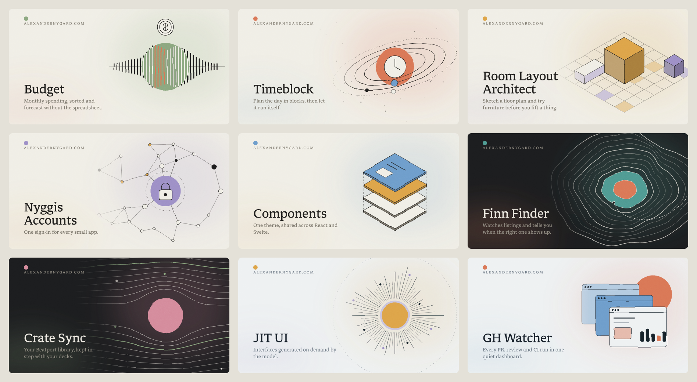
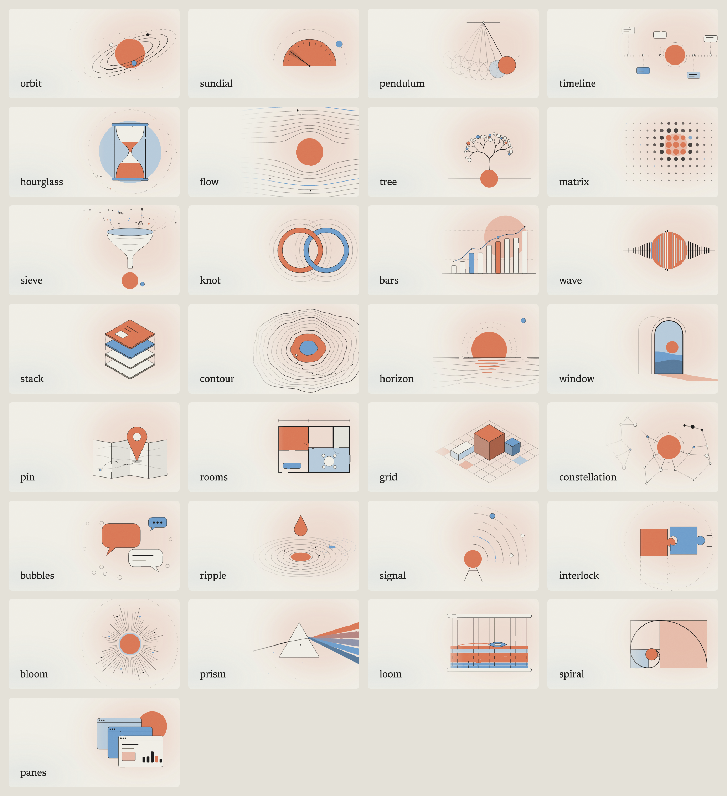

# site-cover

Cover images for all my projects in one house style: warm paper backgrounds, a soft colour haze, an
abstract motif in fine hand-drawn line, an optional small subject drawing, Libron type and paper grain.
Each cover is made from a small JSON spec, so agents can write and regenerate them.



## How it works

```
cover.json ──> compose (palette, layout, motif, subject, type, texture) ──> SVG ──> resvg ──> PNG
```

- **The renderer owns the style.** A spec can only choose from a fixed set of motifs, themes and
  accents. Stroke weights, the wobble filter, grain, type and layout are not configurable from a spec.
  This is what keeps covers from different projects looking like one family.
- **Specs choose the meaning.** The motif is a visual metaphor (orbit for time, flow for data, contour
  for maps...). The optional `subject` is a tiny line drawing in a 100×100 box that the renderer
  restyles into the house line weight and palette.
- **Deterministic.** The same spec renders the same image. Change `seed` to reroll the random details.
- **PNG out.** Social sites don't accept SVG for `og:image`, so the CLI rasterises with
  [resvg](https://github.com/RazrFalcon/resvg). No browser needed; a cover renders in well under a second.

## Use

```bash
bun install && bun link          # puts `site-cover` on your PATH
site-cover list                  # motifs, themes, accents, sizes
site-cover render cover.json -o static/og.png
site-cover render --spec '{"title":"Budget","motif":"wave"}' -o og.png --svg
site-cover gallery -o gallery    # render the samples in src/samples.ts
site-cover gallery --motifs      # every motif with the same title and colours, to compare
site-cover render --spec '{"motif":"flow","size":"1920x800","position":"right"}' -o hero.webp --scale 2
```

The same art works on the sites themselves: hero backgrounds, empty states, dividers. Custom sizes,
art position, transparent backgrounds and WebP/SVG output are covered in the "Site art" section of
[skill/SKILL.md](skill/SKILL.md). Apps can also `import { compose } from "site-cover"` to build SVGs
at build time or in the browser; rasterising is in `site-cover/render`.

The spec and the guide for writing one are in [skill/SKILL.md](skill/SKILL.md), which is also the
skill agents load. Install it for Claude Code with:

```bash
ln -s ~/MyStuff/Projects/site-cover-generator/skill ~/.claude/skills/site-cover
```

## Motifs

29 motifs in five groups: time, data, place, connection and making.



## Adding to the style

- New motif: write a function returning `back`, `front` and an `anchor` for the subject in the
  group's file under [src/motifs/](src/motifs/) (shared helpers are in [src/draw.ts](src/draw.ts)),
  register it with a group and description in [src/motifs.ts](src/motifs.ts), then run
  `site-cover gallery --motifs` and compare it with the others.
- New accent or theme: [src/palette.ts](src/palette.ts). Keep accents at similar lightness and
  saturation so they swap cleanly.
- Fonts are Libron (OFL), converted from `@alexandernygard/libron` to TTF for resvg.
